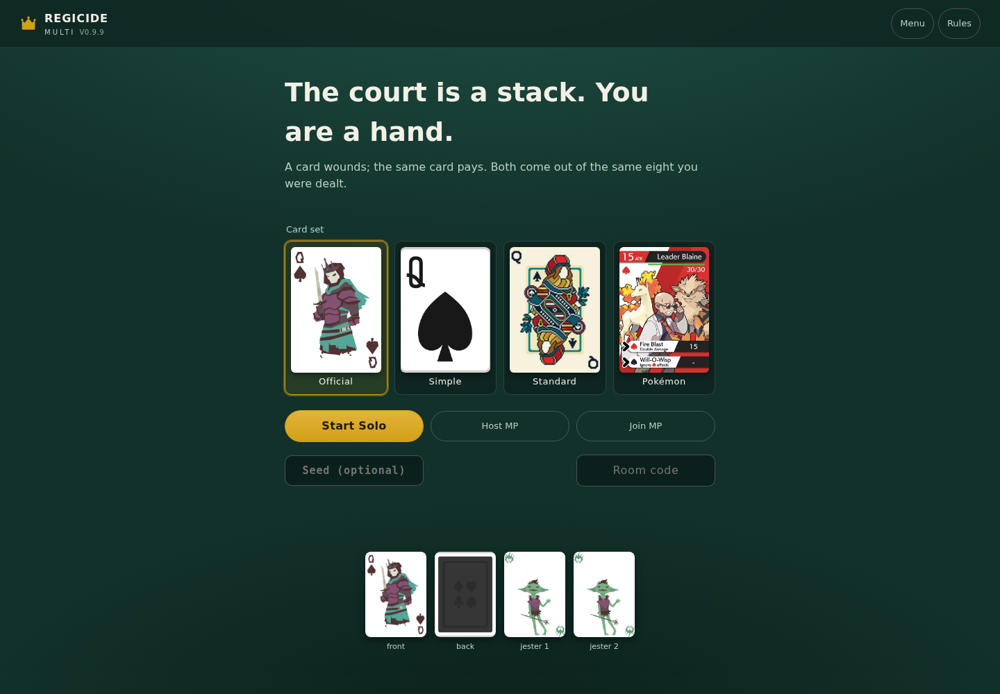
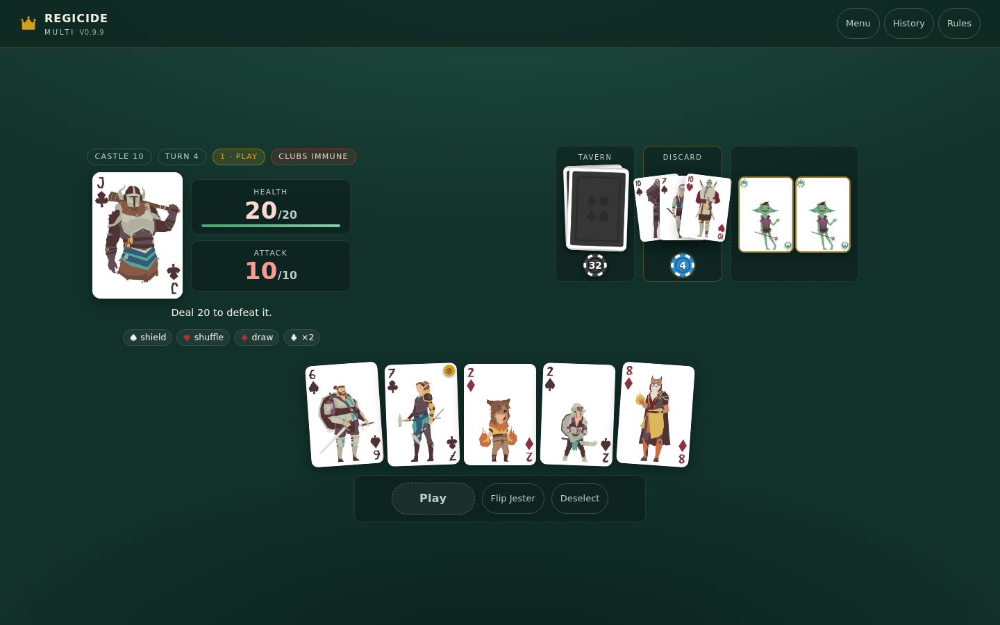
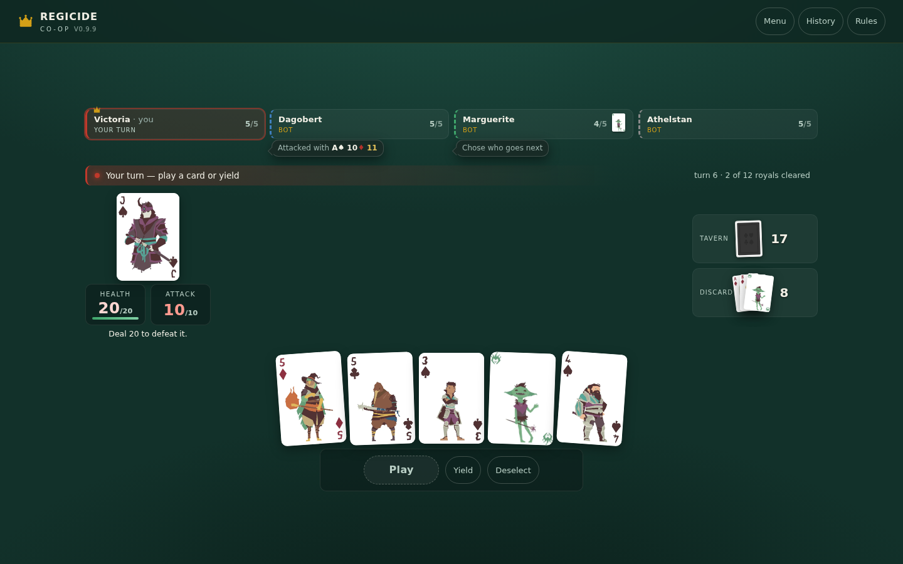
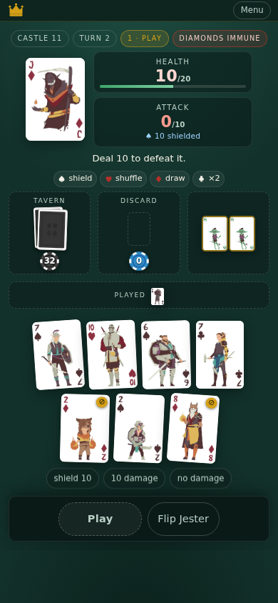
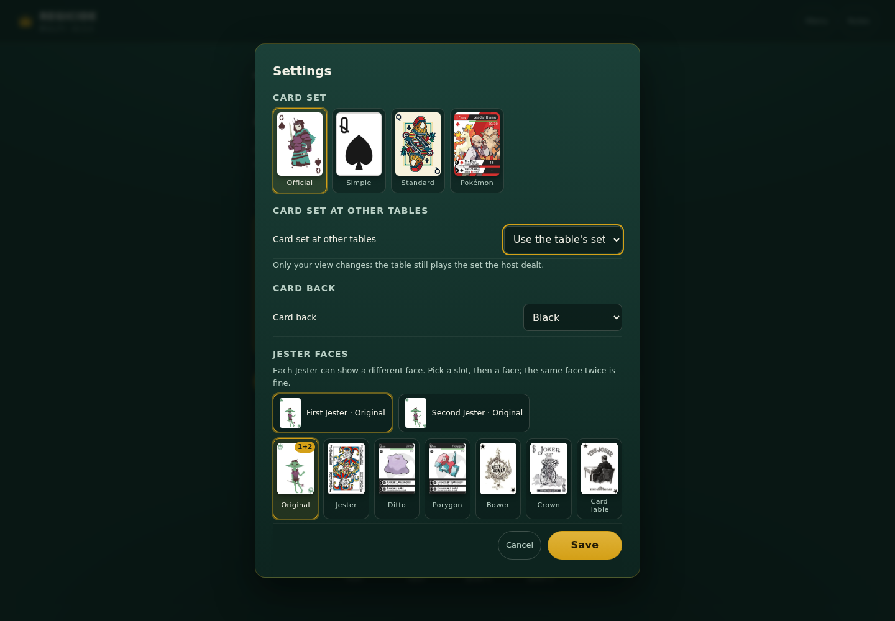

# Regicide — web (solo + co-op)

A self-hosted, server-authoritative web version of **Regicide**, the cooperative card game by
Badgers from Mars. One Go binary serves both modes on one port: solo, and co-op for 2–4 players
sharing a network. The browser is a renderer; the server owns the deck, the seed and the rules.



## This is a fan project

- **Unofficial and unaffiliated.** This project is not connected to, authorised by, sponsored by
  or endorsed by Badgers from Mars, the designers of Regicide, or any other rights holder.
- **Not for sale.** It is free, non-commercial work. Nothing here is sold, and nothing here is a
  product or a service you can buy.
- **No rights assumed.** The names, rules and artwork of Regicide belong to their owners. Nothing
  in this repository claims any ownership of them. See [Credits and licensing](#credits-and-licensing).

## Run it

You need **Go 1.22 or newer**. Nothing else is required to build and serve the game.

```bash
GO111MODULE=off GOPATH=$PWD go build -o bin/regicide regicide/cmd/regicide
./bin/regicide -addr :8321 -data ./data
```

Open <http://localhost:8321>. `-addr` defaults to `:8123` if you leave it out; `-data` is where
sessions, rooms and the leaderboard are kept.

The `scripts/` helpers wrap the same thing:

```bash
./scripts/run.sh                  # build, start in the background on :8321, wait for /api/health
./scripts/stop.sh                 # stop the recorded pid
./scripts/restart.sh              # rebuild + restart (service if installed, else manual)
./scripts/run.sh --addr :9000     # a second instance on another port
DATA_DIR=/var/lib/regicide ./scripts/run.sh --addr :9000
sudo ./scripts/install-service.sh # optional: run :8321 as a systemd or OpenRC service at boot
```

Co-op needs no flag: host a room from the menu and share the five-character code.

## What it does

- **Full official solo ruleset** in a pure Go engine: the four-step turn, all four suit powers
  with the hearts-before-diamonds ordering, combos (2–4 cards totalling ≤ 10), animal companion
  pairing, enemy suit immunity, the exact-kill recruit rule, spade shields, the defeat cascade,
  yielding (off by default), and both solo Jester flips with gold/silver/bronze victory tiers.
- **Co-op tables** for 2–4 players: rooms with seat tokens, host authority, a shared board with
  pointer orbs, spectators, reconnect links, replay download, and bot fill for empty seats.
- **Server-authoritative**: the server owns deck, seed and PRNG. The client sends actions and
  renders sanitised state, so a run cannot be forged and the leaderboard means something.
- **Sessions**: `POST /api/sessions` returns a session; games survive a reload; idle sessions are
  garbage-collected after 24 h.
- **Seeds**: type a seed to replay a deal (leaderboard-ineligible), or let the server pick one and
  reveal it when the game ends.
- **Leaderboard**: top runs per tier (gold = no Jesters, silver = one, bronze = two), nickname
  only, random-seed runs only, one submission per game.
- **Card sets**: an official deck, two synthetic decks (`simple`, `8bit`) and a Pokémon fan
  re-theme; eleven card backs and a set of Jester faces selectable in Settings.
- **Move history**: a drawer lists every move grouped by turn with the impact of each play,
  server-persisted and copyable as text.
- **Mobile + desktop**: one layout from phone portrait to wide desktop, 44 px touch targets,
  keyboard play, `prefers-reduced-motion` respected. On a phone a tap selects and the selected
  cards appear in a peek strip above the Play button; a long press opens any card full size.
- **Sound**: 12 samples from the CrispCards free sampler plus 7 synthesised effects, mutable in
  Settings.

## Screens

| Solo | Co-op (one player, three bots) |
|---|---|
|  |  |

| Phone (solo) | Settings |
|---|---|
|  |  |

## Verify

The gate needs more than the server does:

| Tool | Needed for |
|---|---|
| Go 1.22+ | everything |
| Node 20+ | `scripts/gate.sh`, the JS unit tests, the browser drivers |
| Python 3 + Pillow | the asset `--check` stages |
| Chromium | the UI, co-op, layout and transport browser stages (they print `SKIP` without it) |
| Firefox ESR + geckodriver | the two Gecko layout stages (optional; they print `SKIP` without it) |

```bash
./scripts/gate.sh               # 28 stages: fmt, vet, race tests, coverage, bot bench, JS tests,
                                # asset checks, credits + rules ledgers, and the headless-Chromium
                                # UI, co-op, layout and transport smokes
GATE_FAST=1 ./scripts/gate.sh   # fast lanes only; browser stages print SKIP
```

The gate builds the real binary on an ephemeral port and drives the UI in headless Chromium
through a self-driving harness (`/?test=smoke`, `/?test=coop`), failing on any console error or
cross-origin request.

Individual suites:

```bash
GO111MODULE=off GOPATH=$PWD go test -race ./src/...
node --test src/test/js/*.test.mjs
./scripts/install-hooks.sh       # optional: pre-commit runs the fast half
```

## Layout

```
src/regicide/engine/     pure rules engine + test matrix R-001..R-060
src/regicide/bot/        bot policies and the bench harness
src/regicide/names/      royal names dealt to seats
src/regicide/replay/     game-log format, verification, viewer support
src/regicide/server/     HTTP, sessions, rooms, streams, replay, store, leaderboard, embedded web/
src/regicide/cmd/        regicide (server), replay (log viewer), coopbench, botlab
src/regicide/tools/rngref/  independent RNG reference behind the golden vectors
src/test/                black-box API tests and JS unit tests
tools/assets/            one-shot asset pipelines (their outputs are committed)
docs/                    decisions, rules coverage, credits, replay format, design notes
```

Strict GOPATH mode, zero external Go dependencies:

```bash
GO111MODULE=off GOPATH=$PWD go build -o bin/regicide regicide/cmd/regicide
GO111MODULE=off GOPATH=$PWD go test ./src/...
```

## Regenerate assets

The source material (uncut sheets, art packs, sample libraries) is large and is not in the
repository. With it present in `artifacts/`:

```bash
python3 tools/assets/build_official.py        # official deck faces
python3 tools/assets/build_gfx_themes.py      # simple deck, backs, chips
python3 tools/assets/build_8bit_theme.py      # 8bit (Standard) deck
python3 tools/assets/extract_pokemon.py       # print-and-play sheets -> faces
python3 tools/assets/build_pokemon.py         # faces -> web/img/pokemon/*.webp
python3 tools/assets/build_casino_backs.py    # casino backs
python3 tools/assets/build_joker_set.py       # the Jester face catalogue
python3 tools/assets/build_theme_registry.py  # web/data/themes.json
python3 tools/assets/gen_cardtext.py          # web/data/cardtext.json
python3 tools/assets/gen_credits.py           # docs/CREDITS.md provenance table
python3 tools/assets/synth_sfx.py             # synthesised effects
```

The six builders that produce committed art (`build_official`, `build_gfx_themes`,
`build_8bit_theme`, `build_pokemon`, `build_casino_backs`, `build_theme_registry`) accept
`--check` and are run that way by the gate, so a committed asset that drifts from its pipeline
fails the build. See `docs/CREDITS.md` for provenance and attribution.

## Documentation

`docs/INDEX.md` says which document is authoritative for what. The main ones:

| File | Contents |
|---|---|
| `docs/DECISIONS.md` | Design decisions and rules rulings (ADR-001…, D-1…) |
| `docs/MP-PLAN.md` | Co-op design: rooms, seats, transport, board, spectating |
| `docs/REPLAY-FORMAT.md` | The game log format, verification, and the viewer contract |
| `docs/rules-coverage.md` | Rulebook clause → rule ID → test ledger |
| `docs/BOT.md` | Bot policies, measurements, and what shipped |
| `docs/PROCESS.md` | Branches, the merge gate, ports, and what a change must prove |
| `docs/CREDITS.md` | Asset provenance and attributions |
| `docs/research/01-rules-dossier.md` | The rule matrix the engine is tested against |

## Credits and licensing

**Code.** Everything written for this project is released under the [MIT licence](LICENSE).
That licence covers the source code and documentation, and nothing else.

**Game and artwork.** Regicide is designed by Andy Richdale, Luke Badger and Paul Abrahams, with
art by D.J. Phillips, published by Badgers from Mars. All rights in the game, its name, its rules
and its artwork remain with their owners. This project is an unofficial, non-commercial fan
implementation: it claims no rights, is not affiliated with or endorsed by any rights holder, and
is not for sale.

**Third-party assets.** The official card art, the Pokémon fan re-theme (by Wil Su), the stock
Jester faces and the CrispCards sound samples are included for non-commercial fan use only; they
are **not** covered by the MIT licence and carry their own terms. `docs/CREDITS.md` records the
origin and constraint of every committed asset file.

If you are a rights holder and want something removed, open an issue and it will be taken down.
